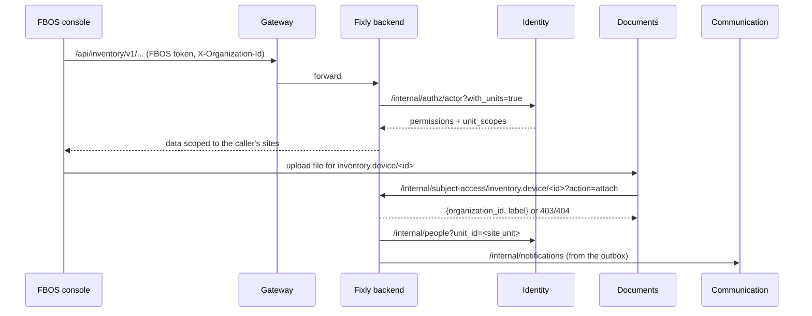

# FBOS services — the Fixly v2 inventory connection

> Branch `ayush-dev4`. Read `SYSTEM.md` (same folder) for the whole system.
> Background: `docs/fixly-v2-integration-plan.md`.

## 1. In one paragraph
FBOS does not store devices. Hardware inventory lives in the **Fixly backend** (Node), which exposes `/api/inventory/v1` as an FBOS-conformant service: it authenticates FBOS users through Identity, checks `inventory.*` permission codes, and uses FBOS error and page shapes. On the FBOS side, three services know about it:
- **Identity:** holds the permission codes and answers who is calling.
- **Gateway:** routes `/api/inventory/*` to the Fixly backend.
- **Documents:** asks the Fixly backend before attaching files to inventory records.

Communication receives the inventory notifications like any other service's. Nothing else in FBOS changed.

## 2. Changes per service

### Identity (`src/v1/01_identity`)
- **`services/permission_catalog.py`:** 31 `inventory.*` codes, each with a description for the access editor:

  | Entity | Codes |
  |---|---|
  | device | read, write |
  | setup | manage |
  | catalog | read, write |
  | cost | read |
  | purchase_order | read, write, approve |
  | goods_receipt | write |
  | stock_transfer | read, write, approve, dispatch, receive |
  | warranty | read, write |
  | issue | read, write, assign |
  | replacement | write, approve |
  | repair_order | read, write, approve |
  | disposal | read, write, approve |
  | maintenance_plan | read, write |
  | report | read |
- **Sensitive reads:** `SENSITIVE_READ_CODES` now also holds `inventory.cost.read`, `inventory.purchase_order.read`, `inventory.repair_order.read`, `inventory.disposal.read` and `inventory.report.read`, so the `member` preset never gets prices, vendor terms, repair costs, disposals or cross-customer reports.
- **Test:** `tests/test_permission_catalog.py` checks those codes stay out of `member` and that `inventory.device.read` is in it.
- **Endpoints the Fixly backend calls (unchanged):**
  - `GET /api/identity/v1/internal/authz/actor?with_units=true` with the caller's `Authorization` and `X-Organization-Id`, plus `X-FBOS-Internal-Token`. It returns `permissions`, `own_records_only` and `unit_scopes`.
  - `GET /api/identity/v1/internal/people?organization_id=&unit_id=`, to find who to notify at a site or customer.
- **Deploy order:** Identity adds new codes on start (`ensure_permission_catalog`), and it must be deployed **before** the Fixly backend serves FBOS users.

### Gateway (`src/v1/00_gateway`)
- `config.py`: `inventory_service_url` (default `http://localhost:3000`).
- `routes/proxy.py`: `"inventory"` added to `SERVICE_URL_MAP`, so `/api/inventory/v1/...` is forwarded to the Fixly backend with all headers. The Fixly backend never trusts forwarded identity headers; it asks Identity itself.
- `.env.example`: `INVENTORY_SERVICE_URL=http://host.docker.internal:3000` (the Fixly backend running on the host in dev).

### Documents (`src/v1/05_documents`)
- `.env.example`: `SUBJECT_SERVICES` includes `"inventory": "http://host.docker.internal:3000/api/inventory/v1"`.
- Subject types `inventory.device`, `inventory.issue`, `inventory.purchase_order`, `inventory.goods_receipt`, `inventory.repair_order` and `inventory.disposal` are checked by the Fixly backend at `/internal/subject-access/{type}/{id}?action=read|attach`. Downtime of the Fixly backend blocks attaching files to those records.

### Communication (`src/v1/06_communication`)
No code change. The Fixly backend's outbox worker calls `POST /internal/notifications` with `source_event_id`, so a retry never notifies twice. Event types are `inventory.<event>.v1`, e.g. `inventory.transfer.dispatched.v1`, `inventory.issue.raised.v1`, `inventory.warranty.expiring.v1`.

### docker-compose.dev.yml
`gateway` and `documents` get `extra_hosts: host.docker.internal:host-gateway`, so containers reach the Fixly backend on the host.

## 3. Data movement involving FBOS

**How tenancy maps** (one Identity organization runs the hardware business):

| Identity | Fixly DB |
|---|---|
| organization | `FBOS_ORGANIZATION_ID` on the Fixly backend; stamped on every inventory row |
| org unit "customer" | `companies.fbos_org_unit_id` |
| org unit "site", under the customer | `clients.fbos_org_unit_id` |
| user | `users.fbos_user_id` (technicians); every `*_user_id` in v2 tables |

Customer staff are `client_user`s with grants scoped to their site's unit. An organization-wide grant to a `client_user` shows them nothing (fail closed).

## 4. Local setup (this machine)
- **Service `.env` files:** each service's `.env` had its shared Hostinger `DATABASE_URL` commented out and the docker `db` URL added (`mysql+aiomysql://root:<MYSQL_ROOT_PASSWORD>@db:3306/fbos_<service>`). Never run migrations against the shared DBs from a dev machine.
- **Identity mail:** Identity's `.env` has `MAIL_ENABLED=false` locally, so dev invitations don't send real email.
- **Dev users:** `fixly_backend/scripts/v2/fbos_dev_bootstrap.mjs` creates them in the local Identity: client `FIXLYDEV`, with password `FixlyDev@12345` for all of them:

  | User | Can do |
  |---|---|
  | `admin@fixlydev.example.com` | client admin |
  | `ops@fixlydev.example.com` | every inventory code |
  | `site-a@fixlydev.example.com` | Rajgir Zoo Safari only |
  | `site-b@fixlydev.example.com` | another customer's site only |
  | `tech@fixlydev.example.com` | technician |

  It also creates the customer and site org units.
- **Start everything:** `~/Projects/fbos/dev-local.sh start` (db, redis and identity; `--full` adds documents and communication).

## 5. Not built on the FBOS side (Phase 5 FBOS half)
The Fixly backend stores links to Revenue contracts and invoices, Delivery projects and tasks, and Control approvals (`contract_id`, `invoice_id`, `work_unit_id`, `task_id`, `approval_request_id`). No new FBOS endpoints read or write them yet, because Fixly and FBOS were kept as separate platforms.
