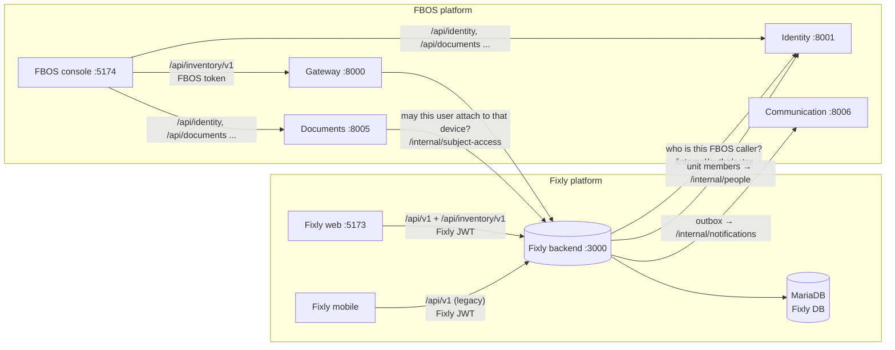
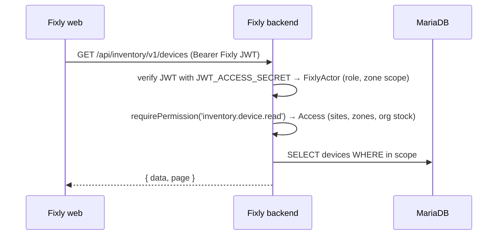
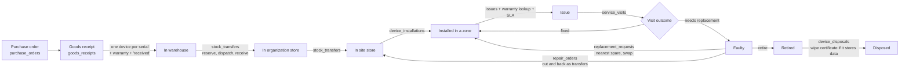
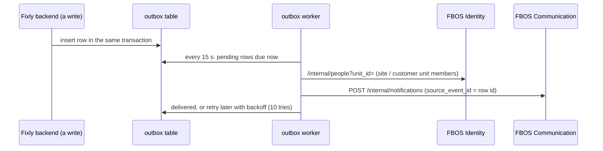

# Fixly v2 — the whole system: four pieces and how data moves

> Same file in all four repos (`fixly_backend`, `fixly_frontend`, `fbos_services`, `fbos_frontend`).
> State as of 2026-10-21, branch `ayush-dev4` in every repo. Each repo also has a doc on its own part.

## 1. The four pieces

| Piece | Repo | Tech | Runs on (local) | Talks to |
|---|---|---|---|---|
| **Fixly backend** | `fixly/fixly_backend` | Node 20, Express, Prisma, MariaDB, Socket.IO, FCM | :3000 | its MariaDB; FBOS Identity (FBOS callers only); FBOS Communication (notifications) |
| **Fixly web** | `fixly/fixly_frontend` | React 19, Vite, Tailwind | :5173 | Fixly backend only |
| **FBOS services** | `fbos_services` | Python FastAPI, 10 services, MySQL, Alembic | gateway :8000, identity :8001, documents :8005, communication :8006, MySQL :3307 | each other; Fixly backend (gateway, Documents) |
| **FBOS console** | `fbos_frontend/clientadmin` | React 18, Vite | :5174 | FBOS services; Fixly backend (`/api/inventory`) |

The Fixly **mobile app** (`fixly/fixly_flutter`) is a fifth client. It still uses the legacy `/api/v1` and is unchanged.

**Fixly and FBOS are two separate platforms.** Each has its own users and sign-in:
- Fixly: `users` table, 5 fixed roles (`super_admin`, `client_admin`, `zone_incharge`, `zone_staff`, `technician`), Fixly JWT.
- FBOS: Identity service, per-user permission codes, organizations and org units.

Both platforms use **one inventory API** in the Fixly backend, `/api/inventory/v1`, so the rules for devices live in one place.



## 2. What the Fixly backend serves

| Path | For | Sign-in | Notes |
|---|---|---|---|
| `/api/v1/*` | Fixly web (old screens), Fixly mobile | Fixly JWT | Unchanged contract. Device writes now also update the v2 columns and history (see 4.3). |
| `/api/inventory/v1/*` | Fixly web (Hardware Lifecycle pages), FBOS console | Fixly JWT **or** FBOS token | Devices from purchase to disposal. FBOS-style errors `{detail:{code,message,status,meta}}`, cursor pages, snake_case. Mounted only when `INVENTORY_API_ENABLED=true`. |
| `/api/inventory/v1/internal/subject-access/:type/:id` | FBOS Documents | FBOS token + `X-FBOS-Internal-Token` | Answers whether the caller may read or attach files on an inventory record. |
| Socket.IO, FCM | Fixly web, mobile | Fixly JWT | Live issue updates and push. Fired the same way for issues changed through either API. |

## 3. Who may do what

### 3.1 Fixly users (Fixly JWT)
A Fixly role becomes a fixed set of inventory permissions. Fixly's zone scope becomes the record scope. Defined in `fixly_backend/src/modules/inventory/auth/fixlyActor.js`.

| Role | Sees | Can do |
|---|---|---|
| super_admin | everything | everything (purchasing, repairs, disposals, reports, costs) |
| client_admin | their site's devices, plus their organization's stock not yet sent to a site | edit and install devices, set up zones and stores, move their stock (transfers), issues (raise, assign), approve replacements, read maintenance plans. No prices, purchasing, repairs, disposals or reports. |
| zone_incharge, zone_staff | devices in their zones (and sub-zones) | raise and follow issues, daily status |
| technician | devices in their coverage; issues assigned to them or open in coverage | install, take out, swap, receive transfers, raise and work issues, request replacements |

The rule is checked by a test (`scripts/inventory_fixly.test.mjs`): every role sees **exactly the same devices** through `/api/inventory/v1` as through the legacy `/api/v1`.

### 3.2 FBOS users (FBOS token)
Permission codes `inventory.<entity>.<action>` are in Identity's catalog. Each user holds codes, optionally limited to org units. The backend asks Identity on every request (cached 30 s) and maps unit scopes to sites. Each customer and each site is an org unit (`companies.fbos_org_unit_id`, `clients.fbos_org_unit_id`).
- **Unscoped grant (operator staff):** sees everything.
- **Grant on a site's unit:** sees only that site.
- **Customer staff (`client_user`) with an organization-wide grant:** sees **nothing** (fail closed), so a `member` preset can never show one customer another customer's devices.
- **Costs are sensitive:** prices and costs are only sent with `inventory.cost.read`. That code, plus the purchase-order, repair, disposal and report reads, is in Identity's `SENSITIVE_READ_CODES`, so the `member` preset never gets them.

Records outside the caller's scope answer **404**, never 403, so ids can't be probed.

## 4. How data moves

### 4.1 A request from Fixly web


### 4.2 A request from the FBOS console
```mermaid
sequenceDiagram
    participant C as FBOS console
    participant G as Gateway / Vite proxy
    participant B as Fixly backend
    participant I as FBOS Identity
    participant D as MariaDB
    C->>G: GET /api/inventory/v1/devices (Bearer FBOS token, X-Organization-Id)
    G->>B: forwarded
    B->>B: not a Fixly JWT → ask Identity
    B->>I: GET /internal/authz/actor?with_units=true
    I-->>B: user, permissions, unit_scopes, own_records_only
    B->>B: org must be FBOS_ORGANIZATION_ID, else 404; units → sites
    B->>D: SELECT devices WHERE in scope
    B-->>C: { data, page }
```
If Identity can't be reached, the answer is **503**, never "allowed".

### 4.3 Old screens keep the new data correct
The mobile app and the old Fixly web screens still write through `/api/v1`. Every legacy device write goes through `syncFromLegacy` (`fixly_backend/src/modules/inventory/domain/deviceState.js`) in the same transaction:
- **Deploy to a zone:** the active installation is closed and a new one opened, the lifecycle state and site are set, and one history event is written.
- **Status change** (retire, or derived from issues and daily logs): sets the lifecycle state and writes an event.
- **New unit:** state "in organization store" at the organization's store, owner from `INVENTORY_DEFAULT_OWNERSHIP`.

New-API writes go through `changeDeviceState`. It checks the state machine and the single-place rule, then writes both the v2 and the legacy columns. Up to Phase 5, `devices.status` is written from the state. In Phase 6 the database computes it from the state.

### 4.4 The life of a device (tables written at each step)

Every change of state, place or holder writes one row to `device_lifecycle_events` in the same transaction. That table is the device's timeline on both apps.

The 14 states: in warehouse, reserved, in transit, in organization store, in site store, installed, under maintenance, faulty, pending replacement, under repair, at vendor (RMA), retired, disposed, lost.

### 4.5 Notifications (Fixly backend → FBOS)

- Events sent: transfer dispatched and received, device received, issue raised, assigned and resolved, replacement approved, repair returned, warranty expiring (60/30/7 days), maintenance scheduled.
- The worker runs only with `OUTBOX_WORKER_ENABLED=true`. Without it, rows wait in the outbox.
- Fixly users keep getting Socket.IO and FCM push for issues as before.

### 4.6 Files (FBOS Documents)
The console uploads a file for subject `inventory.device/<id>`. Documents asks the Fixly backend `GET /internal/subject-access/inventory.device/<id>?action=attach` with the user's token and gets back `{organization_id, label}`, or 403/404. Subject types: `inventory.device`, `inventory.issue`, `inventory.purchase_order`, `inventory.goods_receipt`, `inventory.repair_order`, `inventory.disposal`.

### 4.7 Scheduled work (outbox worker, once a day)
- **Warranty expiry notices:** sent once per step, tracked in `warranties.last_notice_days`.
- **Preventive maintenance visits:** each due visit is generated once from `maintenance_plans`.

## 5. Where the data lives

| Data | Owner | Others store |
|---|---|---|
| Fixly users, roles, zones, sites (clients), organizations (companies) | Fixly DB | FBOS ids on the Fixly row (`fbos_user_id`, `fbos_org_unit_id`, `fbos_customer_id`) |
| Devices, models, vendors, POs, GRNs, stock, transfers, installations, warranties, issues, visits, replacements, repairs, disposals, maintenance plans | Fixly DB | nothing (FBOS reads them through the API) |
| FBOS users, organizations, org units, permissions | FBOS Identity DB | Fixly stores their ids in `*_user_id` columns |
| Files | FBOS Documents | `device_documents.document_id` |
| Contracts, invoices | FBOS Revenue | `warranties.contract_id`, `repair_orders.invoice_id`, `maintenance_plans.contract_id` |
| Projects, tasks | FBOS Delivery | `device_installations.work_unit_id`, `task_id` |

The two sides never share tables or databases. They reference each other only by UUID.

## 6. Running it all locally
`~/Projects/fbos/dev-local.sh start` starts the FBOS docker containers (db, redis, identity), the Fixly backend, Fixly web and the FBOS console, all on test data:
- **Fixly DB:** `test_fixly_v2`, a copy of the live dump.
- **FBOS:** the docker MySQL.

Logins:
- **Fixly web, http://localhost:5173:** any Fixly user (for example `super@fillip.com`), password `Fixly@12345`.
- **FBOS console, http://localhost:5174:** `ops@fixlydev.example.com`, password `FixlyDev@12345` ("Organization" tab).

`./dev-local.sh reset` rebuilds the test data.
