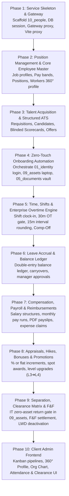

# Service `10_people` (HCM & ATS) Step-by-Step Implementation Plan

> **Architectural Alignment:** Directly modeled on the patterns, standards, and conventions established in [`09_assets`](file:///home/shadow/Projects/fbos/fbos_services/src/v1/09_assets/), [`01_identity`](file:///home/shadow/Projects/fbos/fbos_services/src/v1/01_identity/), and [`03_delivery`](file:///home/shadow/Projects/fbos/fbos_services/src/v1/03_delivery/), incorporating industry benchmarks from **Workday HCM & Time Tracking**, **UKG / Kronos**, **Greenhouse**, and **Rippling**.

---

## 1. Architecture Patterns & Standards Grounding

By inspecting the existing services, the following core conventions will be adhered to in `10_people`:

| Area | Established Codebase Convention | Implementation in `10_people` |
|---|---|---|
| **Language & Framework** | Python 3.12, FastAPI 0.115+, Pydantic v2 | Same stack in `src/v1/10_people`. |
| **Database & ORM** | SQLAlchemy 2.0 (async), `Base.metadata`, Alembic migrations | `database/session.py` with async connection pool, `types.py` for UUID/JSON. |
| **Port & Internal Mapping** | Port `8010:8000` (Container internal 8000) | `8010` published for gateway/dev. |
| **Multi-Tenancy** | `organization_id` mandatory on all business tables | Filtered via `CurrentActor.organization_id`. |
| **Actor & Auth Resolution** | `IdentityClient.resolve_actor` with JWT secret fallback | Direct JWT decoding fallback using `JWT_SECRET` for resilience. |
| **Pagination** | Base64-encoded keyset cursor pagination (`PageResponse[T]`) | `services/pagination.py` using `(order_by, id)` tiebreaker. |
| **Code Generation** | `CodeSequence` with row-level locks (`with_for_update`) | Sequential codes: `EMP-2026-0001`, `JOB-2026-0001`, `POS-2026-0001`. |
| **Route Prefixing** | Dual mount `/v1` and `/api/people/v1` in `router.py` | Full backward & forward compatibility with and without reverse proxy prefixes. |
| **Gateway Proxy** | `SERVICE_URL_MAP["people"]` in `00_gateway/routes/proxy.py` | Reverse proxy `/api/people/v1/*` to `http://people:8000`. |
| **Frontend Routing** | Lazy routes in `App.jsx`, `ACCESS` rules in `navigation.jsx` | `src/features/people/` with `api.js`, `utils.js`, `components/`, and `pages/`. |

---

## 2. Phased Implementation Roadmap



---

## Phase 1: Service Skeleton, Gateway & Scaffolding

### 1.1 Backend Service Directory Structure
Scaffold `fbos_services/src/v1/10_people/`:
```
fbos_services/src/v1/10_people/
├── alembic.ini
├── config.py
├── database/
│   ├── base.py
│   ├── insert_ignore.py
│   ├── session.py
│   └── types.py
├── dependencies.py
├── Dockerfile
├── .dockerignore
├── .env.example
├── exceptions.py
├── __init__.py
├── main.py
├── migrations/
│   ├── env.py
│   ├── script.py.mako
│   └── versions/
├── models/
│   ├── __init__.py
│   └── platform.py
├── permissions.py
├── requirements.txt
├── router.py
├── routes/
├── schemas/
├── services/
│   ├── codes.py
│   ├── identity_client.py
│   └── pagination.py
└── start.sh
```

### 1.2 Gateway Integration
1. In `fbos_services/src/v1/00_gateway/config.py`:
   ```python
   people_service_url: str = "http://people:8000"
   ```
2. In `fbos_services/src/v1/00_gateway/routes/proxy.py`:
   ```python
   SERVICE_URL_MAP["people"] = settings.people_service_url
   ```
3. In `fbos_services/docker-compose.yml`:
   ```yaml
   people:
     build:
       context: ./src/v1/10_people
     ports:
       - "8010:8000"
     env_file: ./src/v1/10_people/.env
     depends_on:
       db:
         condition: service_healthy
     restart: on-failure
     healthcheck:
       test: ["CMD", "curl", "-f", "http://localhost:8000/health"]
       interval: 30s
       timeout: 5s
       retries: 3
   ```

### 1.3 Permissions Catalog in `01_identity`
Add permission definitions to `fbos_services/src/v1/01_identity/services/permission_catalog.py`:
- `people.recruitment.read`, `people.recruitment.manage`
- `people.employee.read`, `people.employee.manage`
- `people.attendance.read`, `people.attendance.manage`
- `people.leave.apply`, `people.leave.approve`
- `people.compensation.read`, `people.compensation.manage`
- `people.separation.manage`

### 1.4 Frontend Proxy Configuration
1. In `fbos_frontend/clientadmin/vite.config.js`:
   ```javascript
   const PEOPLE_URL = process.env.PEOPLE_URL || process.env.API_URL || 'http://localhost:8010'
   // Proxy:
   '/api/people': {
     target: PEOPLE_URL,
     changeOrigin: true,
   }
   ```
2. In `fbos_frontend/clientadmin/src/shared/api/paths.js`:
   ```javascript
   export const PEOPLE = '/api/people/v1'
   ```

---

## Phase 2: Position Management & Core Employee Master

### 2.1 Models (`models/worker.py` & `models/job_architecture.py`)
- `JobProfile`: `id`, `organization_id`, `job_code`, `title`, `job_family`, `job_level` (`L1`–`L7`), `pay_band_id`, `status`.
- `PayBand`: `id`, `organization_id`, `grade_code`, `currency`, `minimum_annual`, `midpoint_annual`, `maximum_annual`.
- `Position`: `id`, `organization_id`, `position_code` (`POS-YYYY-XXXX`), `job_profile_id`, `unit_id`, `reports_to_position_id`, `budgeted_fte`, `hiring_status` (`vacant`, `filled`, `frozen`), `effective_from`.
- `Worker`: `id`, `organization_id`, `worker_code` (`EMP-YYYY-XXXX`), `user_id` (FK to `01_identity.users.id`), `first_name`, `last_name`, `work_email`, `phone`, `date_of_birth`, `gender`, `emergency_contact`, `bank_details`, `tax_id`.
- `PositionAssignment`: `worker_id`, `position_id`, `is_primary`, `effective_start_date`, `status` (`active`, `probation`, `on_leave`, `terminated`).
- `WorkerTimelineEvent`: `id`, `worker_id`, `event_type` (`hire`, `promotion`, `transfer`, `hike`, `resigned`), `effective_date`, `previous_state`, `new_state`.
- `WorkerDocument`: `worker_id`, `document_type`, `document_id` (FK to `05_documents`), `verified`, `verified_by`.

### 2.2 Endpoints (`routes/workers.py` & `routes/positions.py`)
- `GET /api/people/v1/positions`: List and filter positions (vacant, filled, department).
- `POST /api/people/v1/positions`: Create new budgeted position seat.
- `GET /api/people/v1/workers`: Keyset-paginated search of employee directory with department and status filters.
- `GET /api/people/v1/workers/{id}`: Detailed 360° employee profile (job, reporting manager, direct reports, emergency contacts, active assets).
- `PATCH /api/people/v1/workers/{id}`: Update bio/bank/emergency metadata.
- `GET /api/people/v1/workers/{id}/timeline`: Retrieve temporal career milestones.

---

## Phase 3: Talent Acquisition & Structured ATS

### 3.1 Models (`models/recruitment.py`)
- `JobRequisition`: `id`, `organization_id`, `requisition_code` (`REQ-YYYY-XXXX`), `position_id`, `title`, `hiring_manager_id`, `openings_count`, `status` (`draft`, `open`, `paused`, `filled`).
- `Candidate`: `id`, `organization_id`, `first_name`, `last_name`, `email`, `phone`, `resume_doc_id` (in `05_documents`), `linkedin_url`, `source`, `tags`.
- `JobApplication`: `id`, `candidate_id`, `requisition_id`, `current_stage_id`, `status` (`active`, `offered`, `hired`, `rejected`), `rating`.
- `InterviewPlan` & `InterviewStage`: Requisition interview pipeline stages and focus competencies.
- `ScorecardSubmission`: `application_id`, `stage_id`, `interviewer_user_id`, `overall_recommendation`, `attribute_ratings` (1-5 rubrics), `is_blinded`.
- `JobOffer`: `application_id`, `offered_position_id`, `base_annual_salary`, `sign_on_bonus`, `expected_start_date`, `is_out_of_band`, `offer_letter_doc_id`, `status` (`draft`, `approved`, `sent`, `accepted`, `declined`).

### 3.2 Business Logic & Endpoints (`routes/recruitment.py`)
- `POST /api/people/v1/requisitions`: Open job requisition tied to vacant position.
- `POST /api/people/v1/candidates`: Upload candidate profile & resume to `05_documents`.
- `POST /api/people/v1/applications/{id}/stage`: Transition candidate across pipeline stages.
- `POST /api/people/v1/interviews/{id}/scorecard`: Submit blinded interviewer scorecard. Scorecards remain hidden until all interviewers on the panel submit.
- `POST /api/people/v1/offers`: Generate offer. Validates against `PayBand`. If out-of-band, marks `is_out_of_band = True` and flags for VP approval.

---

## Phase 4: Zero-Touch Onboarding & Inter-Service Automation

### 4.1 Automated Conversion Flow
When HR triggers `POST /api/people/v1/offers/{offer_id}/accept-and-onboard`:
1. **Worker Creation:**
   - Converts `Candidate` $\rightarrow$ `Worker`.
   - Generates sequential `EMP-YYYY-XXXX`.
   - Links `PositionAssignment` to the requisition's `position_id` (marks position as `filled`).
2. **Inter-Service Orchestration:**
   - **`01_identity`:** Calls `POST /api/identity/v1/users` passing name, work email, organization, and base role to auto-provision login. Attaches returned `user_id` to `Worker.user_id`.
   - **`09_assets`:** Calls `POST /api/assets/v1/custody/handover` to dispatch a hardware allocation task (laptop, monitor, ID card) to IT.
   - **`05_documents`:** Moves signed offer letter and uploaded identity proofs into `/employees/{worker_code}/compliance/`.
   - **`07_management`:** Calls `POST /api/management/v1/resources` to initialize worker capacity (1.0 FTE, 480 mins/day).

---

## Phase 5: Time, Shifts & Enterprise Overtime Engine

### 5.1 Models (`models/attendance.py`)
- `WorkShift`: `id`, `name`, `start_time`, `end_time`, `grace_period_minutes` (15m), `half_day_hours` (4h), `full_day_hours` (8h), `min_overtime_threshold_minutes` (30m), `overtime_rounding_interval_minutes` (15m), `is_overtime_eligible`.
- `DailyAttendance`: `id`, `worker_id`, `work_date`, `clock_in_time`, `clock_out_time`, `working_minutes`, `is_late`, `status` (`present`, `half_day`, `absent`, `holiday`, `on_leave`).
- `OvertimeRecord`: `id`, `worker_id`, `work_date`, `raw_extra_minutes`, `rounded_overtime_hours`, `compensation_type` (`cash_overtime` vs `comp_off`), `status` (`pending`, `approved`, `rejected`), `project_task_id` (FK to `03_delivery.tasks.id`), `approved_by`.

### 5.2 Core Enterprise Overtime Logic
```python
def calculate_overtime(shift: WorkShift, clock_out: datetime) -> float:
    shift_end = datetime.combine(clock_out.date(), shift.end_time)
    raw_minutes = int((clock_out - shift_end).total_seconds() / 60)
    
    # Gate 1: 30-Minute Qualification Threshold
    if raw_minutes < shift.min_overtime_threshold_minutes:
        return 0.0  # Incidental departure delay
        
    # Gate 2: 15-Minute Interval Rounding (7/8 Minute Rule)
    # 30-37m -> 30m (0.5h), 38-52m -> 45m (0.75h), 53-67m -> 60m (1.0h)
    rounded_quarter_hours = round(raw_minutes / 15.0)
    return rounded_quarter_hours * 0.25
```

---

## Phase 6: Leave Accrual & Balance Ledger

### 6.1 Models (`models/absence.py`)
- `LeavePlan`: `code` (`ANNUAL`, `SICK`, `CASUAL`, `COMP_OFF`, `PARENTAL`), `annual_quota`, `carryforward_max`, `is_encashable`.
- `LeaveAccrualLedger`: `worker_id`, `leave_plan_id`, `transaction_type` (`accrual`, `deduction`, `carryover`, `adjustment`, `encashment`), `units_days` (+/- float), `balance_after`.
- `LeaveRequest`: `worker_id`, `leave_plan_id`, `start_date`, `end_date`, `days_count`, `status` (`pending`, `approved`, `rejected`), `approver_id`.

### 6.2 Calendar Integration
When a leave request is submitted:
- Queries [`01_identity.work_calendars`](file:///home/shadow/Projects/fbos/fbos_services/src/v1/01_identity/) for the employee's branch to automatically exclude regional public holidays and weekends from leave day deductions.

---

## Phase 7: Compensation, Payroll & Reimbursements

### 7.1 Models (`models/payroll.py`)
- `SalaryStructure`: `worker_id`, `basic_salary`, `hra`, `special_allowance`, `pf_deduction`, `pt_deduction`, `tds_tax`, `gross_monthly`, `annual_ctc`.
- `PayrollRun`: `organization_id`, `year`, `month`, `total_workers`, `total_gross`, `total_net`, `status` (`draft`, `processed`, `disbursed`).
- `Payslip`: `payroll_run_id`, `worker_id`, `payable_days`, `unpaid_days`, `overtime_pay`, `reimbursements_pay`, `gross_earned`, `total_deductions`, `net_payable`, `pdf_document_id`.
- `ReimbursementClaim`: `worker_id`, `category` (`travel`, `food`, `broadband`, `medical`), `amount`, `spent_date`, `receipt_doc_id` (in `05_documents`), `status` (`submitted`, `manager_approved`, `finance_approved`, `paid`).

### 7.2 Monthly Payroll Run Calculation
$$\text{Net Pay} = (\text{Payable Days} \times \text{Daily Basic}) + \text{Overtime Pay} + \text{Approved Reimbursements} - \text{Taxes/PF}$$

---

## Phase 8: Appraisals, Hikes, Bonuses & Promotions

### 8.1 Models (`models/progression.py`)
- `CompensationRevision`: `worker_id`, `revision_type` (`annual_hike`, `promotion_hike`, `market_correction`), `increment_pct`, `new_annual_ctc`, `effective_date`, `increment_letter_doc_id`.
- `BonusDisbursement`: `worker_id`, `bonus_type` (`performance`, `spot_award`, `referral`, `festival`), `amount`, `payout_month`, `approved_by`.
- `PromotionRecord`: `worker_id`, `previous_job_profile_id`, `new_job_profile_id`, `previous_level`, `new_level`, `effective_date`, `promotion_letter_doc_id`.

---

## Phase 9: Separation, Clearance Matrix & Full-and-Final (F&F)

### 9.1 Models (`models/separation.py`)
- `SeparationCase`: `worker_id`, `resignation_date`, `contractual_lwd`, `agreed_lwd`, `notice_shortfall_days`, `status` (`initiated`, `clearance_pending`, `settled`, `exited`).
- `ExitClearance`: `separation_id`, `department` (`it_assets`, `finance`, `admin`, `team_lead`, `hr`), `status` (`pending`, `cleared`, `blocked`), `cleared_by`.
- `FullAndFinalSettlement`: `separation_id`, `unpaid_worked_days_amount`, `encashable_leaves_amount`, `notice_shortfall_deduction`, `asset_damage_deductions`, `net_payable`, `relieving_letter_doc_id`.

### 9.2 IT Asset Recovery Gate & LWD Deactivation
1. **IT Clearance Gate:**
   - Queries `GET /api/assets/v1/assets?custody_id={user_id}&status=in_use`.
   - IT Clearance is strictly **blocked** if `active_custodies > 0`.
2. **LWD Midnight Automation (23:59):**
   - Calls [`01_identity`](file:///home/shadow/Projects/fbos/fbos_services/src/v1/01_identity/): `POST /api/identity/v1/users/{id}/deactivate` (kills active JWTs and locks login).
   - Generates digitally signed **Relieving Letter** and **Experience Certificate** via [`05_documents`](file:///home/shadow/Projects/fbos/fbos_services/src/v1/05_documents/).
   - Marks `Worker.status = 'exited'`.

---

## Phase 10: Client Admin Frontend (`fbos_frontend/clientadmin`)

### 10.1 Feature Modules in `src/features/people/`
- `api.js`: API endpoints for jobs, candidates, employees, attendance, leaves, payroll, expenses, and exits.
- `utils.js`: Currency formatters, badge colors, date utilities.
- `components/`:
  - `CandidateKanban.jsx`: Drag-and-drop hiring pipeline.
  - `ScorecardModal.jsx`: Interview evaluation form.
  - `AttendancePunchWidget.jsx`: Clock-in/Clock-out button with Wi-Fi/Geofence check.
  - `OvertimeClaimModal.jsx`: Overtime submission with project ticket selector.
  - `ClearanceMatrixView.jsx`: Department clearance checklists with IT hardware check.
- `pages/`:
  - `RecruitmentJobs.jsx` (`/people/jobs`)
  - `CandidatePipeline.jsx` (`/people/candidates`)
  - `EmployeeDirectory.jsx` (`/people/employees`)
  - `EmployeeDetail.jsx` (`/people/employees/:id` - 360° Profile)
  - `AttendanceBoard.jsx` (`/people/attendance`)
  - `LeaveManager.jsx` (`/people/leaves`)
  - `PayrollHub.jsx` (`/people/payroll`)
  - `ExpenseClaims.jsx` (`/people/reimbursements`)
  - `SeparationManager.jsx` (`/people/offboarding`)

---

## Verification & Deployment Checklist

1. **Unit & Integration Tests:**
   - Pytest suite for overtime calculation (verifying 29 mins $\rightarrow$ 0h, 35 mins $\rightarrow$ 0.5h, 40 mins $\rightarrow$ 0.75h).
   - Test double-entry leave ledger balance constraints.
   - Test IT clearance blocking when asset is held.
2. **Docker Compose Verification:**
   - Run `docker compose up -d --build people`.
   - Check `curl http://localhost:8010/health` returns `{"status": "ok", "service": "people"}`.
   - Check `curl http://localhost:8000/api/people/v1/health` via gateway.
3. **Frontend Verification:**
   - Run `npm run lint` and `npm run build` in `fbos_frontend/clientadmin`.
