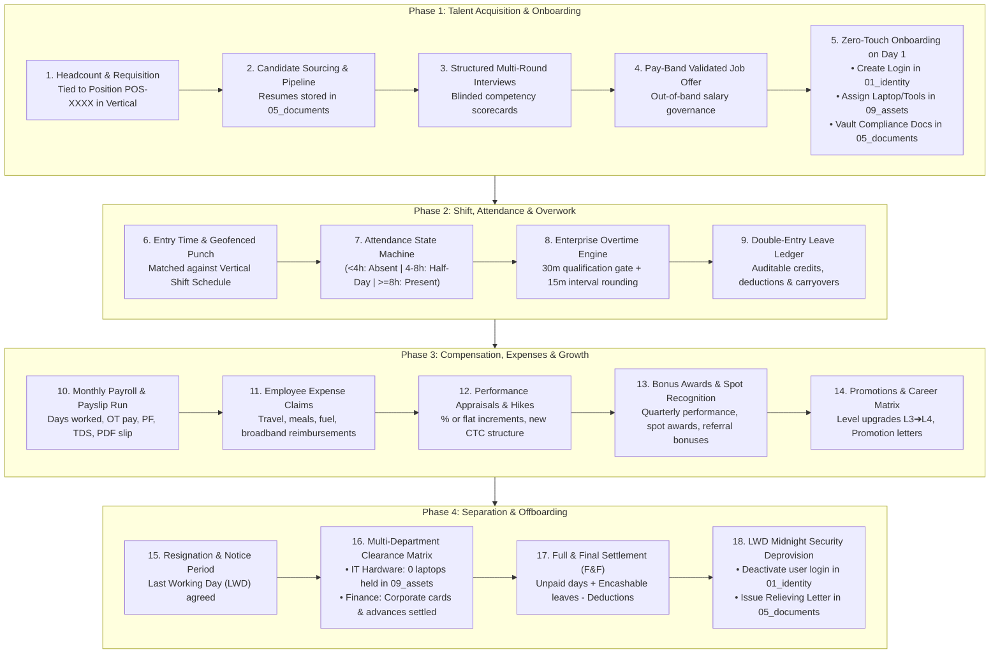
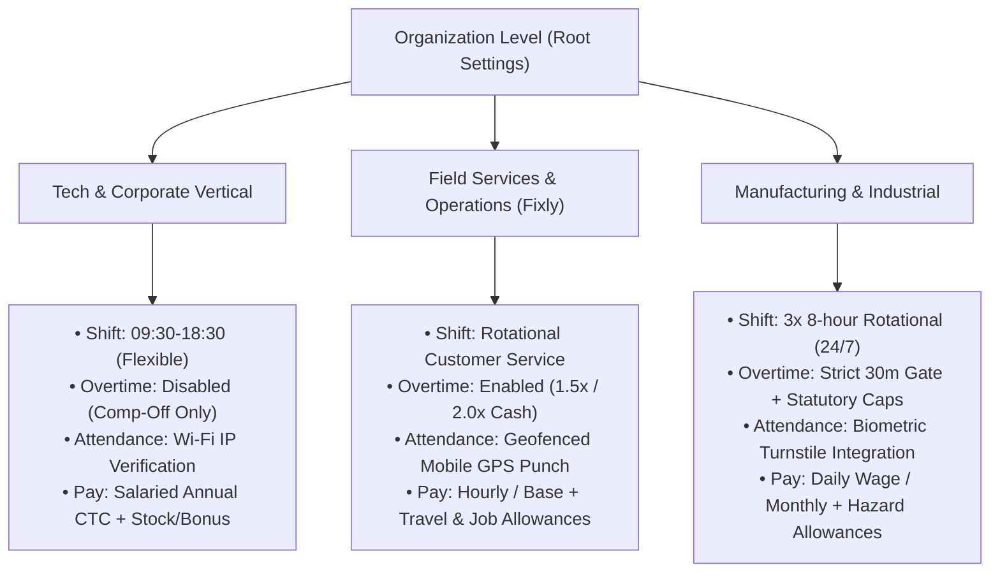
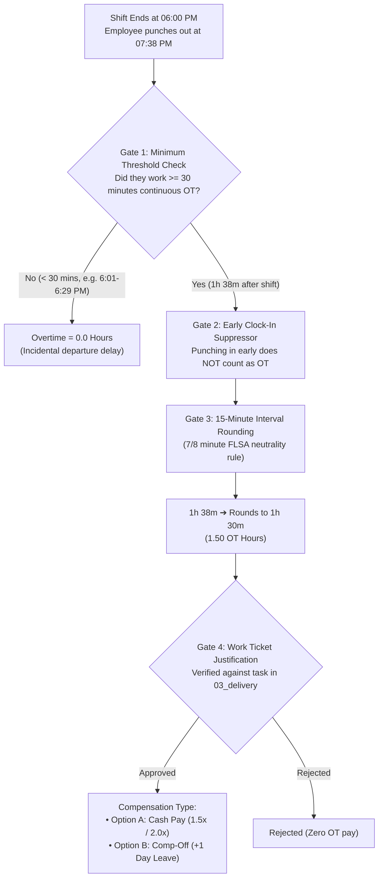

# Enterprise People, Talent & Workforce Management (`10_people`)
## Master Architecture, Multi-Vertical Strategy & Industry Benchmark Reference

---

## 1. Executive Summary & Multi-Vertical Vision

FBOS serves diverse business models—spanning **Software & Professional Services**, **Field Operations & Maintenance (Fixly)**, **Manufacturing & Production**, and **Commercial / Retail Sales**. 

A one-size-fits-all HR tool cannot handle this diversity. Different verticals operate under fundamentally different labor realities:
- **Corporate / Tech Verticals:** Salaried, FLSA-exempt, flexible working windows, Comp-Off over cash OT, equity/bonus rewards.
- **Field & Service Operations (Fixly / Technicians):** Shift-based, geofenced mobile check-ins, hourly overtime rates (1.5x/2.0x), travel/fuel reimbursements, asset custody tracking.
- **Manufacturing & Industrial Units:** 24/7 rotational shifts, biometric turnstiles, statutory overtime caps, break deductions.
- **Retail & Commercial Units:** Weekend shifts as standard working days, rotational week-offs, commission-driven compensation structures.

To support this diversity without code duplication, **`10_people`** is architected with **Scoped Policy Inheritance** (`organization_id` $\rightarrow$ `vertical_id` $\rightarrow$ `unit_id` $\rightarrow$ `position_id`).

---

## 2. Industry Standards Benchmark & Source References

This blueprint is engineered from the production paradigms of Fortune 500 enterprise platforms and statutory labor standards:

| Enterprise System / Benchmark | Architecture Pattern Adopted | Core Industry Source Reference |
|---|---|---|
| **Workday HCM** | **Position Management & Business Process Framework (BPF)** | [Workday OMS & Supervisory Org Architecture](https://www.workday.com), Decoupling Persistent Positions (`POS-XXXX`) from Workers. |
| **Workday Time Tracking** | **Overtime Minimum Thresholds & Calculation Gates** | Workday Time Tracking Calculation Engine: Minimum daily hour gates, consecutive-day overtime triggers, and accumulated period caps. |
| **UKG (Ultimate Kronos Group)** | **Interval Round Rules & Pay Rule Building Blocks** | UKG Workforce Central / Dimensions Work Rules: 15-minute standard interval rounding with 7/8-minute neutral boundary splits. |
| **SAP SuccessFactors** | **Employee Central Foundation Objects & Legal Entities** | SAP SuccessFactors EC Foundation Model: Legal Entity $\rightarrow$ Business Unit $\rightarrow$ Division $\rightarrow$ Department hierarchy. |
| **Greenhouse ATS** | **Structured Hiring & Anti-Bias Competency Rubrics** | Greenhouse Software Structured Interview Framework: Requisition $\rightarrow$ Interview Plan $\rightarrow$ Stages $\rightarrow$ Blinded Focus Scorecards. |
| **Rippling** | **Zero-Touch IT & Identity Life Cycle Orchestration** | Rippling Unified Employee Graph: Instant API orchestration with IAM (`01_identity`) and IT Hardware (`09_assets`). |
| **Labor Standards (FLSA & Factories Act)** | **Net-Neutral Time Rounding & Overtime Multipliers** | U.S. Fair Labor Standards Act (FLSA) 29 CFR § 785.48 (Time clock 7/8 minute rule) and Indian Factories Act § 59 (Overtime at 2x rate). |

---

## 3. High-Level Lifecycle Flow



---

## 4. Multi-Vertical Adaptation Strategy

To serve heterogeneous departments, policies are configured modularly:



---

## 5. Enterprise Overtime (OT) & Extra Work Engine

### The 1-Minute Fallacy vs. Enterprise Reality
Naive HR software calculates overtime by taking `Exit Time - Shift End`, meaning leaving 1 minute late (6:01 PM) pays 1 minute of overtime. 

In enterprise environments (Workday & UKG), accidental departure lingerings are eliminated using **4 Strict Gates**:



### The 5 Operational Overtime Rules:
1. **Minimum Qualification Gate (30 Minutes):** Overtime timer only activates after 30 continuous minutes beyond scheduled shift.
2. **15-Minute Interval Rounding (7/8 Minute Neutral Rule):**
   - `30 to 37 mins` $\rightarrow$ Rounds down to **30 mins** (`0.50 hrs`)
   - `38 to 52 mins` $\rightarrow$ Rounds up to **45 mins** (`0.75 hrs`)
   - `53 to 67 mins` $\rightarrow$ Rounds up to **60 mins** (`1.00 hr`)
3. **Early Arrival Suppressor:** Punching in at 8:40 AM for a 9:00 AM shift starts the timer at 9:00 AM.
4. **Task / Ticket Justification:** Requires linking to an active task in [`03_delivery`](file:///home/shadow/Projects/fbos/fbos_services/src/v1/03_delivery/) and manager approval.
5. **Role Exemption Flag:** Positions marked `is_overtime_eligible = False` (Executives, Engineers) automatically route approved extra hours to **Comp-Off Leave** instead of cash.

---

## 6. End-to-End Functional Modules

### 1. Position Management & Job Architecture
- **Job Profiles:** Corporate matrix defining titles, job families, and levels (`L1` to `L7`).
- **Pay Bands:** Total rewards compensation ranges (Min, Midpoint, Max) with out-of-band escalation rules.
- **Positions (`POS-XXXX`):** Persistent budgeted seats holding department allocation, reporting manager, and FTE budget.

### 2. Talent Acquisition & Structured ATS
- **Requisitions:** Created to backfill vacant positions or approved new headcount.
- **Candidate Pool:** Global profile repository with resumes vaulted in [`05_documents`](file:///home/shadow/Projects/fbos/fbos_services/src/v1/05_documents/).
- **Interview Plans & Blinded Scorecards:** Multi-stage evaluations with 1–5 competency rubrics (hidden from other interviewers until submitted).
- **Offers:** Automated compensation package generation, digital e-signature tracking.

### 3. Zero-Touch Onboarding
- **Identity Auto-Provisioning:** Calls [`01_identity`](file:///home/shadow/Projects/fbos/fbos_services/src/v1/01_identity/) to create login email, password invite, and default RBAC role.
- **IT Hardware Dispatch:** Dispatches a handover ticket to [`09_assets`](file:///home/shadow/Projects/fbos/fbos_services/src/v1/09_assets/) to assign laptops, monitors, and access badges.
- **Document Collection:** Vaults government IDs, signed contracts, and education certificates into [`05_documents`](file:///home/shadow/Projects/fbos/fbos_services/src/v1/05_documents/).
- **Capacity Alignment:** Registers 1.0 FTE capacity in [`07_management`](file:///home/shadow/Projects/fbos/fbos_services/src/v1/07_management/).

### 4. Time, Shifts & Attendance
- **Shifts:** Configurable per department/vertical (Start, End, Grace Period).
- **Punch In/Out:** Real-time entry timestamps with office Wi-Fi IP verification or mobile geofence coordinates.
- **Attendance Calculation:** $\ge 8\text{ hrs} \rightarrow \text{Present}$, $4\text{ to }8\text{ hrs} \rightarrow \text{Half-Day}$, $< 4\text{ hrs} \rightarrow \text{Absent}$.
- **Regularization:** Employee self-service for missed punches with manager approval.

### 5. Double-Entry Leave Ledger
- **Ledger Model:** Operates like a financial ledger (`annual_accrual`, `leave_deduction`, `carryover_cap`, `encashment`).
- **Policies:** Paid Vacation, Sick, Casual, Parental, and Comp-Off.
- **Holiday Integration:** Queries [`01_identity.work_calendars`](file:///home/shadow/Projects/fbos/fbos_services/src/v1/01_identity/) to exclude regional holidays and weekends from leave deductions.

### 6. Compensation, Payroll & Expenses
- **Component-Based CTC:** Basic (40-50%), HRA, Special Allowance, PF (12%), PT, and TDS.
- **Monthly Payroll Run:** Automated calculation based on attendance payable days, overtime pay, and unpaid leaves.
- **Payslip Generation:** Generates digitally signed PDF payslips vaulted in [`05_documents`](file:///home/shadow/Projects/fbos/fbos_services/src/v1/05_documents/).
- **Reimbursements:** Multi-category employee expense claims (Travel, Food, Broadband) with receipt verification and payout via next payroll.

### 7. Appraisals, Hikes, Bonuses & Promotions
- **Salary Hikes:** Periodic appraisal reviews supporting percentage or flat increments with temporal effective dates.
- **Bonuses:** Performance bonuses, spot recognition awards, and candidate referral payouts.
- **Promotions:** Title and level upgrades (e.g. `L3` $\rightarrow$ `L4`), revised reporting hierarchy, and automated promotion letters.

### 8. Separation, Clearance Matrix & Full-and-Final (F&F)
- **Notice Period Management:** Tracks resignation submission, notice shortfall, and agreed Last Working Day.
- **IT Hardware Return Gate:** Clearance queries [`09_assets`](file:///home/shadow/Projects/fbos/fbos_services/src/v1/09_assets/). IT clearance is strictly **blocked** until all laptops and equipment are returned to stock (`active_custodies == 0`).
- **Full & Final Settlement:** Calculates unpaid worked days + encashable leave payout - notice shortfall deductions.
- **Midnight Deprovisioning:** Automatically calls [`01_identity`](file:///home/shadow/Projects/fbos/fbos_services/src/v1/01_identity/) at 23:59 of Last Working Day to disable user access, and issues official Relieving & Experience Certificates.

---

## 7. Inter-Service Architecture Topology

```
                  ┌─────────────────────────────────────────┐
                  │          00_gateway (Port 8000)         │
                  │       Reverse Proxy /api/people/v1      │
                  └────────────────────┬────────────────────┘
                                       │
                                       ▼
                  ┌─────────────────────────────────────────┐
                  │          10_people (Port 8010)          │
                  │   Core HCM, Talent & Workforce Engine   │
                  └──────┬─────┬─────┬─────┬─────┬────┬─────┘
                         │     │     │     │     │    │
       ┌─────────────────┘     │     │     │     │    └────────────────┐
       ▼                       ▼     ▼     ▼     ▼                     ▼
┌──────────────┐ ┌──────────────┐ ┌──────────────┐ ┌──────────────┐ ┌──────────────┐
│ 01_identity  │ │  09_assets   │ │ 05_documents │ │06_communicat.│ │07_management│
│ (Users, Auth,│ │(Laptops, Cust│ │(Files, CVs,  │ │ (Emails, In- │ │(FTE Capacity,│
│  Roles, Orgs)│ │ody, Return)  │ │ Payslips,PDF)│ │  App Alerts) │ │ KPIs, Goals) │
└──────────────┘ └──────────────┘ └──────────────┘ └──────────────┘ └──────────────┘
```

---

## 8. Implementation Roadmap

- **Phase 1: Service Foundation & Position Management**
  - Scaffold `src/v1/10_people` on port `8010`.
  - Wire gateway reverse proxy in `00_gateway`.
  - Schema: `job_profiles`, `pay_bands`, `positions`, `workers`.
- **Phase 2: Talent Acquisition & ATS**
  - Schema: `job_requisitions`, `candidates`, `applications`, `interview_plans`, `scorecards`, `offers`.
- **Phase 3: Zero-Touch Onboarding & Handshakes**
  - Automated identity provisioning with `01_identity`.
  - Hardware dispatch ticket with `09_assets`.
  - Contract vaulting in `05_documents`.
- **Phase 4: Shifts, Attendance & Overtime Engine**
  - Schema: `work_shifts`, `daily_attendance`, `overtime_records`.
  - 30-min gate, 15-min interval rounding, Comp-Off credit engine.
- **Phase 5: Leave Accrual Ledger**
  - Schema: `leave_plans`, `leave_accrual_ledger`, `leave_requests`.
- **Phase 6: Compensation, Payroll & Reimbursements**
  - Schema: `salary_structures`, `payroll_runs`, `payslips`, `reimbursement_claims`.
- **Phase 7: Hikes, Bonuses & Promotions**
  - Schema: `compensation_revisions`, `bonus_disbursements`, `promotions`.
- **Phase 8: Separation, Clearance Matrix & F&F**
  - Schema: `separations`, `exit_clearances`, `full_and_final_settlements`.
  - Zero-asset hardware validation gate in `09_assets` & LWD midnight revocation in `01_identity`.
- **Phase 9: Client Admin Frontend**
  - Full UI implementation in `fbos_frontend/clientadmin`.
